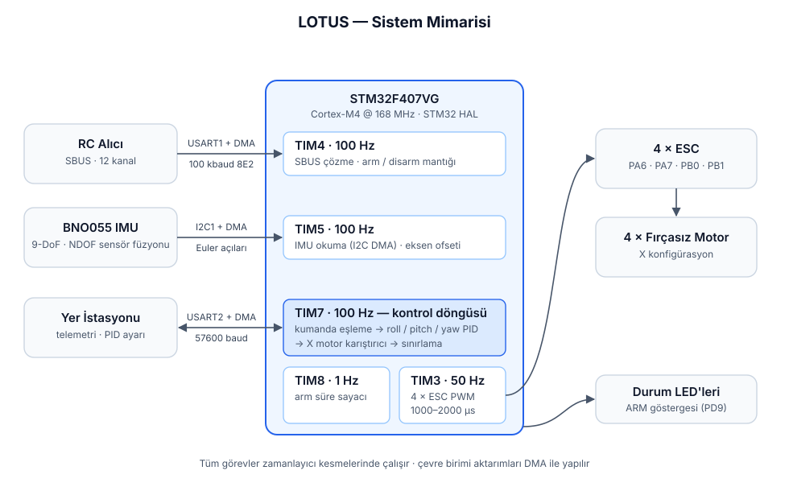
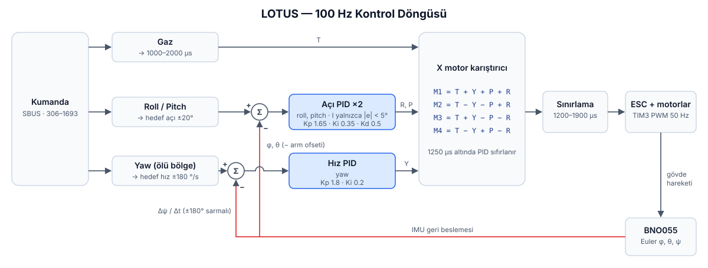
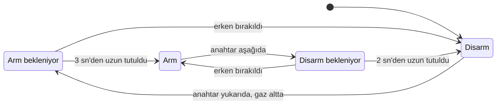

# LOTUS — Yerli Uçuş Kontrol Kartı ve Uçuş Yazılımı

> 🏆 **TEKNOFEST 2022** — Döner Kanatlı İHA Yarışması · **Yerlilik 2.liği Ödülü** (LOTUS)
> 🏆 **TEKNOFEST 2021** — Döner Kanatlı İHA Yarışması · **Yerlilik 2.liği Ödülü** (HUMA)

<!-- TODO: yarışma / uçuş fotoğrafı
<p align="center"></p>
-->

## Proje Hakkında

2020–2022 yılları arasında yürütülen bu projede, quad ve hekza konfigürasyonlu döner kanatlı İHA'ları sürebilecek STM32 tabanlı uçuş kontrol kartları üretilmiş ve bu kartlara ekibimizce geliştirilen uçuş yazılımı entegre edilmiştir. Sensör sürücüleri, kumanda haberleşmesi, duruş kontrolü ve motor sürme katmanlarının tamamı proje kapsamında geliştirilmiştir.

Çalışmanın ilk sürümü TEKNOFEST 2021 Döner Kanat yarışmasında **HUMA** aracı ile kullanılmıştır. Aynı altyapı geliştirilmeye devam edilerek TEKNOFEST 2022'de **LOTUS** aracında uçurulmuştur. İki araç da yarışmalarda **Yerlilik 2.liği** ödülüne layık görülmüştür.


## Yazılımın Kapsamı

- **Duruş kontrolü:** Roll ve pitch eksenlerinde açı kontrolü, yaw ekseninde açısal hız kontrolü yapan PID döngüleri 100 Hz'de çalışmaktadır.
- **Kumanda haberleşmesi:** 12 kanallı SBUS çerçeveleri UART ve DMA ile alınmakta, kanal değerleri bit düzeyinde çözülmektedir.
- **IMU sürücüsü:** Bosch BNO055 için I2C sürücüsü geliştirilmiştir. Sensörün dahili NDOF füzyon modu kullanılmakta, açı verileri DMA ile okunmaktadır.
- **İrtifa kestirimi:** BME280 barometre sürücüsü ve 4 durumlu Kalman irtifa filtresi geliştirilmiştir. Bu modüller manuel uçuş sürümünde kontrol döngüsüne bağlı değildir.
- **Motor karıştırma:** PID çıkışları X konfigürasyona göre motorlara dağıtılmakta, çıkışlar güvenli aralıkta sınırlandırılmaktadır.
- **Arm/disarm güvenliği:** Arm işlemi için anahtarın belirli bir süre tutulması ve gaz kolunun altta olması gerekmektedir. Arm anında IMU açıları sıfır noktası olarak kaydedilmektedir.
- **Yer istasyonu bağlantısı:** PID katsayıları telemetri hattı üzerinden uçuş sırasında güncellenebilmektedir.

## Sistem Mimarisi

<p align="center"></p>

Yazılımdaki tüm görevler donanım zamanlayıcılarının kesmelerinde çalışmakta, çevre birimleriyle veri aktarımı DMA üzerinden yapılmaktadır.

| Görev | Zamanlayıcı | Frekans | Açıklama |
|---|---|---|---|
| Kumanda | TIM4 | 100 Hz | SBUS çerçevesinin alınması, kanalların çözülmesi, arm/disarm kontrolü |
| IMU | TIM5 | 100 Hz | BNO055'ten Euler açılarının okunması ve arm ofsetinin uygulanması |
| Kontrol | TIM7 | 100 Hz | Kumanda eşleme, PID hesabı, motor karıştırma ve ESC çıkışları |
| Arm sayacı | TIM8 | 1 Hz | Arm/disarm anahtarının tutulma süresinin ölçülmesi |
| ESC PWM | TIM3 | 50 Hz | 4 kanal PWM, 1000–2000 µs darbe genişliği |

## Kontrol Döngüsü

<p align="center"></p>

- **Roll / pitch:** Kumandadan gelen değer ±20° hedef açıya dönüştürülür. IMU'dan ölçülen açı ile arasındaki hata PID'e girer. İntegral terimi yalnızca hata 5°'nin altındayken biriktirilir; böylece integral birikmesi (windup) sınırlanır.
- **Yaw:** Kumandadan ±180 °/s hedef açısal hız elde edilir; merkezde bir ölü bölge bulunur. Ölçülen hız, her döngüdeki yön açısı değişiminden hesaplanır.
- **Motor karıştırma:** Gaz (T) ile üç eksenin PID çıkışları X gövdeye göre birleştirilir. Her motor çıkışı 1200–1900 µs aralığında sınırlandırılır. Gaz 1250 µs'nin altındayken PID terimleri sıfırlanarak aracın yerdeyken düzeltme yapması önlenir.

## Arm / Disarm Akışı



Arm tamamlandığında o anki IMU açıları sıfır noktası olarak kaydedilir, ESC PWM çıkışları başlatılır ve ARM LED'i yanar. Disarm işleminde tüm PWM çıkışları durdurulur.

## Donanım

| Bileşen | Parça | Arayüz |
|---|---|---|
| Mikrodenetleyici | STM32F407VG (Cortex-M4F, 168 MHz) | — |
| IMU | Bosch BNO055 (9 eksen, dahili füzyon) | I2C1 @ 100 kHz + DMA |
| Kumanda alıcısı | SBUS çıkışlı alıcı | USART1 RX @ 100 kbaud 8E2 + DMA |
| Telemetri | Yer istasyonu haberleşme hattı | USART2 @ 57600 baud + DMA |
| İtki sistemi | 4 × ESC + fırçasız motor, X konfigürasyon | TIM3 PWM @ 50 Hz |

<details>
<summary><b>Pin haritası</b></summary>

| Sinyal | Pin | Not |
|---|---|---|
| SBUS RX | PA10 | USART1_RX |
| Telemetri TX / RX | PD5 / PD6 | USART2 |
| I2C SCL / SDA | PB6 / PB7 | I2C1 |
| ESC M3 / M4 | PA6 / PA7 | TIM3_CH1 / CH2 |
| ESC M1 / M2 | PB0 / PB1 | TIM3_CH3 / CH4 |
| ARM LED'i | PD9 | |
| Durum LED'leri | PB14 / PB15 | |

</details>

## Depo Yapısı

```
firmware/
├── LOTUS_AFS.ioc            STM32CubeMX yapılandırması (saat, pin, zamanlayıcı, DMA)
├── Core/
│   ├── Src/main.c           Görev zamanlaması, SBUS çözücü, arm mantığı, PID, motor karıştırma
│   ├── Src/HUMA_BNO055.c    BNO055 IMU sürücüsü
│   ├── Src/BME280.c         BME280 barometre sürücüsü
│   ├── Src/KalmanBME280.c   4 durumlu Kalman irtifa filtresi
│   ├── Src/Huma_Telemetry.c Yer istasyonu PID paketi ayrıştırıcı
│   └── ...                  CubeMX tarafından üretilen çevre birimi kurulumları
├── Drivers/                 ST HAL + CMSIS (STM32F4xx)
└── MDK-ARM/                 Keil µVision projesi
docs/
└── diagrams/                Mimari ve kontrol döngüsü diyagramları
```

## Derleme

1. `firmware/MDK-ARM/LOTUS_AFS.uvprojx` dosyası **Keil µVision 5** ile açılır (STM32F4xx DFP kurulu olmalıdır).
2. Proje derlenir ve ST-LINK ile karta yüklenir.

`firmware/LOTUS_AFS.ioc` dosyası STM32CubeMX ile açılarak proje STM32CubeIDE gibi farklı geliştirme ortamları için yeniden üretilebilir. Kullanıcı kodlarının tamamı `USER CODE` blokları içinde yer aldığından yeniden üretimde korunur.

### PID katsayılarının yer istasyonundan ayarlanması

`main.c` içindeki `PID_UART_AYAR` değeri `1` yapıldığında roll/pitch katsayıları koddaki sabit değerler yerine yer istasyonundan alınır. USART2 paket biçimi:

```
K<kp>L<ki>M<kd>N        örnek:  K1.65L0.35M0.5N
```

> ⚠️ **Güvenlik:** Masa başı testlerde pervaneler mutlaka sökülmeli, uçuşlar yalnızca güvenli ve uçuşa izin verilen alanlarda yapılmalıdır.

## Lisans

Bu proje [MIT Lisansı](LICENSE) ile yayımlanmıştır. `firmware/Drivers/` altındaki ST HAL ve CMSIS dosyaları kendi lisanslarına tabidir.

---

**Deniz Can Aykurt** · Gömülü Sistemler ve Robotik Mühendisi
